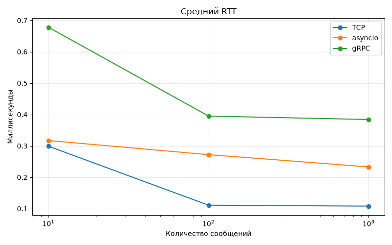
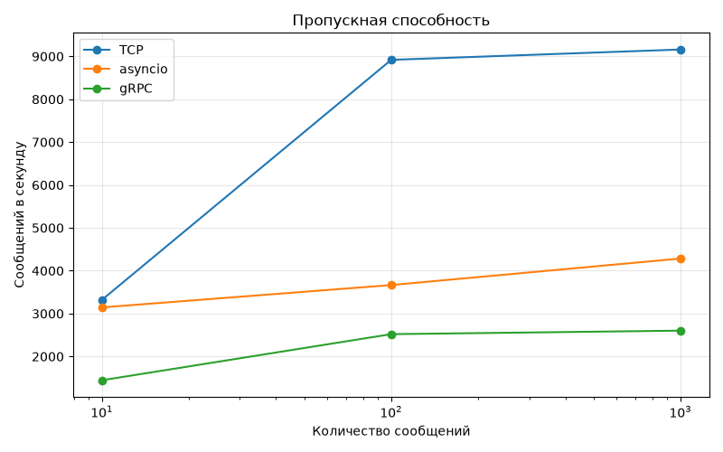

# Лабораторная №1 — Echo Server

Три варианта сервера: `tcp` (потоки), `async_tcp` (asyncio), `grpc_echo` (gRPC).

## Запуск

Открой **три терминала** в корне проекта и запусти серверы:

```powershell
uv run python tcp/server_tcp.py
uv run python async_tcp/server_async.py
uv run python grpc_echo/server_grpc.py
```

В **четвёртом терминале** запусти замеры и построение графиков:

```powershell
uv run python benchmark.py
```

Графики и таблица появятся в `graphs/`. Для проверки 100 TCP-клиентов и 500 asyncio-клиентов есть исходные файлы `tcp/test_concurrent.py` и `async_tcp/client_async.py`.

## Графики



*График 1.* Среднее время ответа при 10, 100 и 1000 сообщениях. Меньше — лучше.



*График 2.* Количество обработанных сообщений в секунду. Больше — лучше.

## Вывод

Многопоточный TCP прост, но создаёт поток на соединение. `asyncio` экономнее работает с большим числом одновременных соединений. gRPC обеспечивает бинарный протокол и стриминг, но добавляет накладные расходы. Итоговые значения зависят от компьютера и условий тестирования. Результаты текущих замеров — в `graphs/results.csv`.
